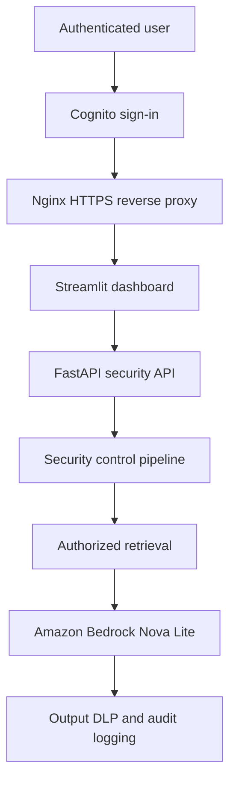

# SentinelShield Security Report

## LLM Prompt-Injection and Data-Leakage Defense Platform

SentinelShield is a secure document-chat application designed to demonstrate how AI applications can defend against prompt injection, unauthorized retrieval, sensitive-data exposure, and malicious document content. The project combines deterministic security controls with a real production LLM deployment on AWS.

## Executive Summary

SentinelShield places security enforcement outside the model. User identity, document authorization, prompt-injection detection, data-loss prevention, and audit logging are handled by application-side controls before and after the LLM call.

The platform supports a vulnerable baseline mode for comparison and a protected mode that enforces authorization and security controls. It is deployed as Dockerized services on Amazon EC2, uses Amazon Bedrock Nova Lite as the LLM, Amazon Cognito for authentication, and Nginx with HTTPS as the public entry point.

## Project Objectives

| Objective | Implementation |
|---|---|
| Detect prompt injection | Instruction-override and sensitive-data extraction detection before retrieval or generation |
| Prevent unauthorized retrieval | Server-side authorization, tenant isolation, role checks, and document filtering |
| Reduce data leakage | Input and output DLP, sensitive-data detection, redaction, and blocking |
| Protect document ingestion | File validation, prompt-injection scanning, and quarantine behavior |
| Produce evidence | Structured JSONL audit events and security decisions |
| Measure effectiveness | Baseline-versus-protected evaluation runner and regression tests |
| Support real deployment | Docker, AWS EC2, Amazon Bedrock, Cognito, Nginx, and HTTPS |

## Architecture



### Request flow

1. The user authenticates through Amazon Cognito.
2. The dashboard sends a bearer token to the FastAPI security API.
3. The API validates the token and establishes the server-side identity.
4. Prompt-injection controls inspect the request before retrieval.
5. Authorization filters documents by user, tenant, role, and classification.
6. Only authorized context is sent to Amazon Bedrock.
7. Output DLP evaluates the generated response for sensitive content.
8. The final decision and security metadata are written to the audit log.

## Security Control Layers

| Layer | Control | Security purpose |
|---|---|---|
| Authentication | Amazon Cognito | Establishes an authenticated user identity |
| Token validation | Server-side JWT validation | Prevents the dashboard from defining its own identity |
| Input protection | Prompt-injection detection | Detects instruction overrides and extraction attempts |
| Authorization | Server-side access checks | Prevents unauthorized document retrieval |
| Tenant isolation | Tenant-aware filtering | Prevents cross-tenant data access |
| Document safety | Ingestion scanning and quarantine | Prevents malicious document instructions from entering the corpus |
| Retrieval control | Protected retrieval pipeline | Limits context to authorized documents |
| LLM boundary | Untrusted-context instructions | Treats document text as data rather than executable instructions |
| Output protection | DLP and redaction | Detects, blocks, or redacts sensitive response content |
| Monitoring | Structured audit logging | Records security decisions and relevant request metadata |
| Evaluation | Baseline/protected comparison | Demonstrates the effect of security controls |
| Infrastructure | Docker, EC2, Nginx, HTTPS | Provides reproducible deployment and encrypted transport |

## Threat Scenarios Tested

| Scenario | Vulnerable behavior | Protected behavior |
|---|---|---|
| Instruction override | Model or application may follow attacker instructions | Request is detected and blocked before the LLM call |
| Payroll extraction | Restricted finance data may be retrieved | Unauthorized retrieval is denied |
| Malicious document | Embedded instructions may influence generation | Document is scanned and can be quarantined |
| Sensitive output | Secrets or PII may appear in the response | Output DLP blocks or redacts the response |
| Client-supplied identity | User may attempt to impersonate another user | Identity is derived from a validated server-side token |
| Cross-tenant retrieval | User may request another tenant’s data | Tenant and authorization filters restrict context |

## Evaluation and Test Evidence

The project includes a repeatable evaluation framework with vulnerable baseline and protected modes. The test suite validates security behavior across authentication, retrieval, prompt-injection detection, document ingestion, DLP, audit logging, and secure API behavior.

| Measurement | Current evidence |
|---|---:|
| Automated security tests | **41 passing tests** |
| Test warnings | 2 dependency deprecation warnings |
| Protected prompt-injection behavior | Blocked before LLM invocation |
| Unauthorized restricted-document behavior | Denied by server-side authorization |
| Production LLM provider | Amazon Bedrock Nova Lite |
| Authentication provider | Amazon Cognito |
| Public transport | HTTPS through Nginx |

The project intentionally avoids claiming detection precision, recall, false-positive rate, or attack-success percentages until those values are generated from the finalized evaluation dataset. Those metrics should be added to this report from `evaluation/results.json` after the final regression run.

## Deployment

### AWS components

| Component | Role |
|---|---|
| Amazon EC2 | Hosts the Dockerized API and dashboard |
| Amazon Bedrock | Provides Amazon Nova Lite inference |
| Amazon Cognito | Provides user authentication |
| IAM instance role | Grants EC2 least-privilege Bedrock invocation access |
| Nginx | Terminates HTTPS and reverse-proxies the dashboard |
| AWS Systems Manager | Provides administrative access without exposing SSH as the application path |
| CloudWatch budget controls | Helps monitor AWS spending |

### Container services

| Service | Responsibility | Exposure |
|---|---|---|
| `api` | FastAPI security and retrieval API | Localhost only; accessed through the internal Docker network |
| `dashboard` | Streamlit user interface | Localhost only; public traffic enters through Nginx |
| `nginx` | HTTPS reverse proxy | Public ports 80/443 |

The API and dashboard ports are bound to localhost so that Nginx is the only public application entry point.

## Security Design Decisions

### Why the model is not the security boundary

The LLM is treated as a probabilistic component that can be influenced by malicious input or untrusted document text. Authorization and tool/data permissions are therefore enforced by the application before the model receives context.

### Why vulnerable and protected modes exist

The vulnerable baseline demonstrates what happens when retrieval and authorization are not enforced server-side. The protected mode makes the security improvement observable and measurable.

### Why document text is treated as untrusted

Documents can contain instructions designed to manipulate the model. SentinelShield separates document content from system-level control instructions and scans uploaded files before they enter the retrieval corpus.

## Current Limitations and Next Improvements

The current Cognito deployment uses a controlled single-user mapping to the existing synthetic `alice` identity. This validates the authentication flow and protected application behavior, but a multi-user production deployment should map each Cognito subject to a dedicated application user, tenant, role, and authorization policy.

The next core improvements are:

1. Add authenticated-user context so questions such as “What training did I complete?” resolve naturally to the signed-in user.
2. Replace the temporary single-user mapping with a persistent Cognito-subject-to-user mapping.
3. Generate and publish the finalized precision, recall, false-positive, latency, and attack-success measurements.
4. Add CI/CD security regression checks and dependency scanning.
5. Move durable documents and audit records to controlled cloud storage when scale or recovery requirements justify it.

## Reproduction Overview

```powershell
python -m pytest -q
```

Expected baseline result:

```text
41 passed, 2 warnings
```

The deployed application uses:

```text
LLM_PROVIDER=bedrock
AWS_REGION=us-east-2
BEDROCK_MODEL_ID=amazon.nova-lite-v1:0
AUTH_MODE=cognito
```

No AWS access keys are stored in the repository. EC2 accesses Bedrock through its IAM instance role, and Cognito client secrets remain outside the source package in the protected deployment environment.

## Interview Summary

> I built SentinelShield to demonstrate that prompt-injection defense cannot rely on model instructions alone. The application enforces identity, authorization, retrieval boundaries, input detection, output DLP, and audit logging outside the model, then measures vulnerable versus protected behavior through automated security tests. I deployed the system with Docker on AWS EC2, integrated Amazon Bedrock Nova Lite and Cognito, and exposed it through an HTTPS reverse proxy.

## Repository Structure

```text
app/                 FastAPI API and security controls
dashboard/           Streamlit dashboard
data/                Synthetic users and documents
docs/                Threat model and security documentation
evaluation/          Attack cases, runner, and security report
tests/               Automated security and API tests
Dockerfile           Container image definition
docker-compose.yml   Local and EC2 service orchestration
METRICS.md           Measurement definitions
```

## Security Disclaimer

This project uses synthetic documents and demonstration identities. It is intended for security engineering education, portfolio demonstration, and controlled testing. It should not be connected to production confidential data without additional review, multi-user authorization mapping, secrets management, monitoring, backup, and compliance controls.
